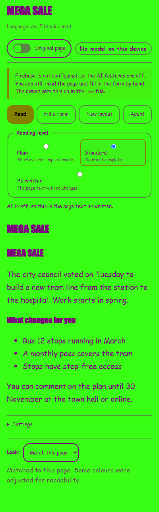

# Distill for Chrome - build it yourself

While Distill's core is in development, the Chrome extension is not in the Chrome Web Store and there is no download.
You build it from this repository with your own Firebase project and load it into Chrome yourself. It takes about
fifteen minutes. If you only want to try Distill, use the web app instead (see the root README).

## Why there is no download yet

Distill calls Firebase AI Logic, and every call is protected by **Firebase App Check**, which proves the request comes
from the real app. The hosted web app proves this with reCAPTCHA Enterprise, but reCAPTCHA does not run inside a Chrome
extension. An extension needs a custom App Check provider (a small server that attests the extension), and that does
not exist yet.

Until it does, the extension uses an App Check **debug token**. A debug token lets anything that holds it past App
Check, so it must never be published: a token baked into a public download would open your Firebase project to
everyone. That is why each person builds the extension with their own project and their own token, and why this
repository publishes no zip or packaged extension.

## What you need

- **Node.js 22** or newer (`node --version` shows it).
- **Chrome 138** or newer.
- A Google account for a free Firebase project.

## Steps

1. **Get the code and install.** In a terminal:

   ```sh
   git clone <this repository's URL> distill
   cd distill
   npm install
   ```

2. **Create your own Firebase project.** In the [Firebase console](https://console.firebase.google.com/), add a project,
   then add a **Web app** to it (Project settings > Your apps > Add app > Web). Keep the page with the app's config open.

3. **Turn on what Distill uses.** In the console:
   - **AI Logic**: open it and choose the Gemini Developer API.
   - **Authentication**: under Sign-in method, enable **Anonymous**.
   - **Firestore**: create a database. It holds settings and shared form guides, never what you type into a form.

   Distill still runs without Authentication and Firestore; it only keeps your settings on this device.

4. **Fill in `.env`.** At the repository root, copy the example and fill it from the web app's config:

   ```sh
   cp .env.example .env
   ```

   Fill every `VITE_FIREBASE_*` line. Leave `VITE_RECAPTCHA_ENTERPRISE_SITE_KEY` empty for the extension.
   `.env` is ignored by git; never commit it.

5. **Register your own App Check debug token.**
   - Make a token: `node -e "console.log(crypto.randomUUID())"`.
   - In the console, open **App Check > Apps**. If your web app is not registered yet, register it with a reCAPTCHA
     provider (App Check asks for one before it offers debug tokens; the extension itself never uses that key).
   - In the app's menu choose **Manage debug tokens**, add the token, and give it a name such as "my Chrome".
   - Put the same token in `.env` as `VITE_APPCHECK_DEBUG_TOKEN=...`.

6. **Build the extension.**

   ```sh
   npm run build -w @distill/extension
   ```

   The result is the folder `apps/extension/dist`.

7. **Load it into Chrome.**
   - Open `chrome://extensions`.
   - Turn on **Developer mode** (top right).
   - Click **Load unpacked** and choose the folder `apps/extension/dist`.
   - Pin Distill from the puzzle-piece menu, open any web page, and click the Distill icon. The side panel opens.

## Keep your build private

Your `apps/extension/dist` folder contains your own debug token. Do not zip it, upload it or share it. If a token
leaks, delete it under **Manage debug tokens** and make a new one.

## Updating

```sh
git pull
npm install
npm run build -w @distill/extension
```

Then click the reload arrow on the Distill card in `chrome://extensions`.

## If something does not work

- **"Firebase is not configured"**: a `VITE_FIREBASE_*` line in `.env` is empty. Fill it, build again, reload.
- **AI requests fail with an App Check error**: the token in `.env` is not registered under Manage debug tokens for
  the same web app, or you built before adding it. Check it, build again, reload.
- **"Distill cannot read this page"**: Chrome does not let extensions read some pages (the Chrome Web Store,
  `chrome://` pages). Click the Distill icon again on a normal web page.

## The look of the side panel

By default the side panel takes the look of the page you are on: its colours, fonts and rounded corners. It changes
any colour that would be hard to read, and tells you when it did. Choose **Look: Distill style** at the bottom of the
panel to keep Distill's own look everywhere. If your computer is set to ask for more contrast, Distill always uses its
own style.

The panel reads only the page's computed styles for this, never what you type and never the page's text. The theme
rules are in `apps/web/src/ui/theme/` (`roles.ts` is the authority; `derive.ts` makes a page's theme).



