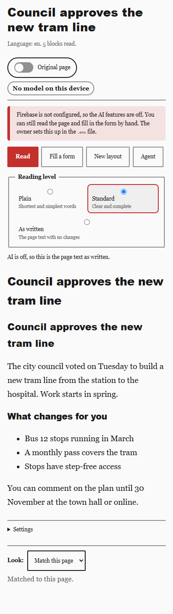
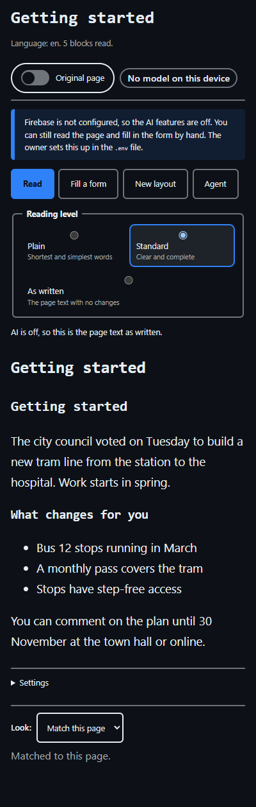

# Distill for Chrome

There are two ways to get the Distill extension. They differ in where the AI runs.

| | Download (public build) | Build it yourself (own build) |
| --- | --- | --- |
| AI | Only Gemini Nano, the model built into Chrome, on your computer | On your computer first; the cloud when your computer cannot help |
| Without the on-device model | The page as written, a simple form guide and the reading view; no AI | Page tasks use the cloud; suggestions and checks for your answers stay off |
| Saved online | Nothing | Settings and form guides (never your answers) in your own Firebase project |
| Firebase project or token | Not needed | Your own project and your own App Check debug token |
| Extension id | `pbmfhppffaiedhljpgpigancfhknohol` | the same (both carry the repository's public `key`) |

In both, what you type into a form stays on your device. See the [privacy policy](https://distill-hybrid-ai.web.app/privacy.html)
for exactly what each version keeps and where.

## Route 1: download the public build

1. Download `distill-extension-<version>.zip` from the repository's
   [Releases page](https://github.com/xkazm04/distill/releases) (under **Assets** - not "Source code", which is the
   repository) and unzip it into a folder you will keep.
2. Open `chrome://extensions`, turn on **Developer mode** (top right), click **Load unpacked** and choose that folder:
   the one with `manifest.json` directly inside it. "Manifest file is missing or unreadable" means the chosen folder is
   one level too high or too low (the repository's `apps/extension` folder is not an extension either; its build is).
3. Pin Distill from the puzzle-piece menu, open a web page and click the Distill icon. The side panel opens.
4. The panel's model card shows the state of Chrome's built-in model. If it says "ready to download", click
   **Download the model**. Chrome decides whether a computer can run it (Chrome 138 or newer, a desktop computer with
   enough memory and free disk space; see [Chrome's built-in AI](https://developer.chrome.com/docs/ai/get-started)).

This build never calls the cloud, so it needs no App Check and holds no credential: it is safe to share. If the model
is not ready, every AI feature says so plainly and Distill shows what it can without AI.

### Making the zip (maintainers)

```sh
npm run pack:extension   # -> apps/extension/release/distill-extension-<version>.zip (keeps the manifest key)
npm run pack:store       # -> apps/extension/release/distill-extension-<version>-store.zip (key stripped, for the Web Store)
```

Both need the Firebase web config in `.env` (`VITE_FIREBASE_API_KEY`, `_PROJECT_ID`, `_APP_ID`: public by design; the
AI SDK needs them even on the device), build the public variant (`npm run build:public -w @distill/extension`, output
`apps/extension/dist-public`), run `check-dist` on it (it fails on any reCAPTCHA code, App Check debug-token hook, App
Check or Firestore endpoint, or a never-ship credential), scan the zip's bytes again, and write the extension id to
`apps/extension/release/extension-id.txt`. `apps/extension/release/` is ignored by git; upload the zip to a GitHub
release by hand. The download keeps the manifest `key`, so the extension id is the same on every computer and the
Handrail native host can allow exactly that id. The Web Store refuses a `key` and assigns its own id, so the store zip
strips it (see [store/listing.md](store/listing.md)). The private half of the key is kept outside the repository by
the maintainer; the repository holds only the public key.

## Route 2: build it yourself

This build can also use the cloud when your computer cannot help, and it saves settings and form guides in Firestore.
You build it from this repository with your own Firebase project and load it into Chrome yourself. It takes about
fifteen minutes.

### Why this build is private to you

Distill calls Firebase AI Logic, and every cloud call is protected by **Firebase App Check**, which proves the request
comes from the real app. The hosted web app proves this with reCAPTCHA Enterprise, but reCAPTCHA does not run inside a
Chrome extension. An extension needs a custom App Check provider (a small server that attests the extension), and
that does not exist yet.

Until it does, this build uses an App Check **debug token**. A debug token lets anything that holds it past App
Check, so it must never be published: a token baked into a public download would open your Firebase project to
everyone. That is why each person builds this version with their own project and their own token, and why only the
public build (which has no token) is ever packaged.

### What you need

- **Node.js 22** or newer (`node --version` shows it).
- **Chrome 138** or newer.
- A Google account for a free Firebase project.

### Steps

1. **Get the code and install.** In a terminal:

   ```sh
   git clone <this repository's URL> distill
   cd distill
   npm install
   ```

2. **Create your own Firebase project.** In the [Firebase console](https://console.firebase.google.com/), add a project,
   then add a **Web app** to it (Project settings > Your apps > Add app > Web). Keep the page with the app's config open.

3. **Turn on what Distill uses.** In the console:
   - **AI Logic**: open it and choose the Gemini Developer API.
   - **Authentication**: under Sign-in method, enable **Anonymous**.
   - **Firestore**: create a database. It holds settings and shared form guides, never what you type into a form.

   Distill still runs without Authentication and Firestore; it only keeps your settings on this device.

4. **Fill in `.env`.** At the repository root, copy the example and fill it from the web app's config:

   ```sh
   cp .env.example .env
   ```

   Fill every `VITE_FIREBASE_*` line. Leave `VITE_RECAPTCHA_ENTERPRISE_SITE_KEY` empty for the extension.
   `.env` is ignored by git; never commit it.

5. **Register your own App Check debug token.**
   - Make a token: `node -e "console.log(crypto.randomUUID())"`.
   - In the console, open **App Check > Apps**. If your web app is not registered yet, register it with a reCAPTCHA
     provider (App Check asks for one before it offers debug tokens; the extension itself never uses that key).
   - In the app's menu choose **Manage debug tokens**, add the token, and give it a name such as "my Chrome".
   - Put the same token in `.env` as `VITE_APPCHECK_DEBUG_TOKEN=...`.

6. **Build the extension.**

   ```sh
   npm run build -w @distill/extension
   ```

   The result is the folder `apps/extension/dist`.

7. **Load it into Chrome.**
   - Open `chrome://extensions`.
   - Turn on **Developer mode** (top right).
   - Click **Load unpacked** and choose the folder `apps/extension/dist`.
   - Pin Distill from the puzzle-piece menu, open any web page, and click the Distill icon. The side panel opens.

### Keep your build private

Your `apps/extension/dist` folder contains your own debug token. Do not zip it, upload it or share it. If a token
leaks, delete it under **Manage debug tokens** and make a new one.

## Updating

**Download**: unzip the new release over the same folder (or into a new one and Load unpacked again), then click the
reload arrow on the Distill card in `chrome://extensions`. The extension id stays the same.

**Build it yourself**:

```sh
git pull
npm install
npm run build -w @distill/extension
```

Then click the reload arrow on the Distill card in `chrome://extensions`.

## If something does not work

- **"This version of Distill uses only the AI model on this device, and it is not ready on this device"** (download):
  open the model card in the side panel. "Ready to download": click **Download the model** and wait. "No model on this
  device": this computer cannot run Chrome's built-in model; Distill still shows the page as written, a simple form
  guide and the reading view. For cloud AI, use the web app or build the extension yourself.

- **"Firebase is not configured"**: a `VITE_FIREBASE_*` line in `.env` is empty. Fill it, build again, reload.
- **AI requests fail with an App Check error**: the token in `.env` is not registered under Manage debug tokens for
  the same web app, or you built before adding it. Check it, build again, reload.
- **"Distill cannot read this page"**: Chrome does not let extensions read some pages (the Chrome Web Store,
  `chrome://` pages). Click the Distill icon again on a normal web page.

## The look of the side panel

By default the side panel takes the look of the page you are on: its colours, fonts and rounded corners. It changes
any colour that would be hard to read, and tells you when it did. Choose **Look: Distill style** at the bottom of the
panel to keep Distill's own look everywhere. If your computer is set to ask for more contrast, Distill always uses its
own style.

The panel reads only the page's computed styles for this, never what you type and never the page's text. The theme
rules are in `apps/web/src/ui/theme/` (`roles.ts` is the authority; `derive.ts` makes a page's theme).




